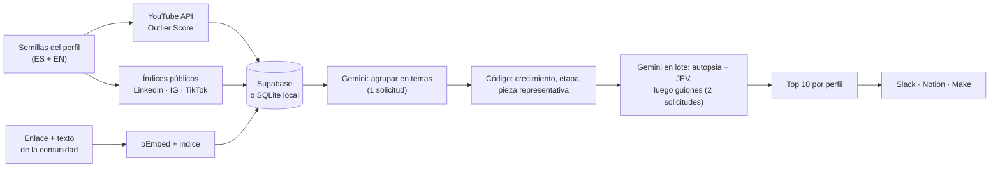

# 30X Radar de tendencias

**Qué temas están creciendo esta semana en LinkedIn, Instagram, TikTok y YouTube, por qué funcionan, si le sirven a tu audiencia y el guion listo para grabar.**

Hecho para el equipo de Media de **30X** (IA para líderes, fundadores y equipos de Latinoamérica) y configurable para cualquier marca, medio o creador.

> Guion de la demo y preguntas del jurado: [`docs/DEMO.md`](docs/DEMO.md)

---

## El problema

30X decide qué producir buscando referentes en cuatro redes. Hoy depende de servicios de scraping que cuestan miles de dólares al año y **solo traen datos**: no dicen por qué algo funcionó, si la tendencia empieza o ya todos la copiaron, ni si le sirve a su audiencia. Es el mismo problema de cualquier marca que produce contenido continuamente.

## La solución en una pantalla

La primera pantalla responde el entregable del reto: **"¿cuáles son los 10 temas que más están creciendo esta semana en LinkedIn, por qué y cómo lo adaptamos?"**

| Pregunta del reto | Cómo la responde la app |
|---|---|
| **¿Cómo se detecta una tendencia que apenas empieza?** | Cada tema se mide **esta semana frente a la anterior**, en español **e** inglés. 🌱 Emergente = acelera en inglés y casi no existe en español. En YouTube, además, el **Outlier Score**: cuántas veces superó la pieza el promedio de su propio canal. |
| **¿Por qué funcionó?** | Autopsia de **5 variables** de la pieza que mejor representa el tema: Gancho, Formato, Tema, Momento y Autor vs. contenido. |
| **¿Es relevante para la audiencia?** | **Score JEV (0-100)**: impacto en negocio (40 %), aplicable sin un gran equipo técnico (35 %) y claridad (25 %), evaluados para la audiencia del perfil. |
| **¿Cómo lo adaptamos?** | Reel por segundos para la voz personal (**@andresbilbao**) y carrusel por slides para la voz de marca (**@30x**), con ángulo contrarian obligatorio si el tema está saturado. Se envía a Slack, Notion o Make en un clic. |

Es **el hueco, no el taladro**: el equipo no recibe un tablero para interpretar, recibe el lunes resuelto.

---

## Cómo cumple los criterios de evaluación

| Criterio | Qué hay en el proyecto |
|---|---|
| **Impacto en el reto (30 %)** | Responde las tres preguntas y el entregable literal (Top 10 de temas por crecimiento semanal, con porqué y adaptación). Validado con datos reales: 400+ piezas en 4 redes. Sensor de Comunidad: el equipo pega un enlace y recibe la misma autopsia. |
| **Innovación (20 %)** | IA con intención: el código calcula crecimiento, Outlier, etapa y la ponderación del JEV (reproducible); Gemini solo interpreta, con salida estructurada validada. Fecha exacta de cada post **decodificada del ID público de la URL**. Semana **anclada a la cobertura real del índice** de LinkedIn. Detección temprana bilingüe. Análisis en lote: 3 solicitudes por radar. |
| **Viabilidad técnica (20 %)** | Next.js 16 + TypeScript estricto. `npm run check` = tipos + prueba de humo (crecimiento, privacidad, perfiles, filtros, retención, cumplimiento) + build. 4 migraciones validadas en PostgreSQL 17 real. Reintentos ante saturación de la IA, errores explicados, autopsias que no se pierden si fallan los guiones. |
| **Viabilidad de implementación (20 %)** | Cabe en los **planes gratuitos** de Gemini, YouTube y Tavily. **100 % legal y sin datos personales.** Plug & Play con Slack, Notion y Make. Supabase en la nube con solo cambiar variables. Código de acceso para publicar la demo. Diagnóstico de claves sin exponerlas (`npm run doctor`). |
| **Presentación (10 %)** | Interfaz clara con modo oscuro, ayuda contextual ("?") en cada métrica y "Cómo funciona" en tres pasos. Guion de 5 minutos y respuestas a preguntas difíciles en [`docs/DEMO.md`](docs/DEMO.md). |

---

## Datos abiertos, legales y sin datos personales

Regla del reto: contenido público sí; datos privados, contenido detrás de un login o técnicas que dependan de violar términos de servicio, no.

| Fuente | Para qué | Por qué es legal |
|---|---|---|
| **YouTube Data API v3** | Vistas, suscriptores y promedio del canal → Outlier Score | API oficial con clave propia |
| **Tavily** (Google Programmable Search como respaldo) | Publicaciones públicas indexadas de LinkedIn, Instagram y TikTok | Índice de búsqueda: nunca se visita la red social |
| **oEmbed** (YouTube, TikTok, Instagram) | Metadatos de los enlaces que pega el equipo | Protocolo oficial de embebido |
| **Jina Reader** | Texto de artículos de la **web abierta** | **Nunca** se usa sobre LinkedIn, Instagram ni TikTok |
| **Comunidad 30X** | Enlace + texto que la persona vio y pega a mano | Es un humano compartiendo contenido público |
| **Google Gemini 3.8 Flash** | Agrupar temas, autopsia, JEV y guiones | Solo salida estructurada validada |

- **Nunca** se usan logins, cookies, cuentas de terceros ni descargas de páginas de redes cerradas, ni directas ni a través de terceros.
- **Nada de datos personales:** el motor analiza piezas, no personas. No guarda nombres, handles, perfiles, miniaturas, correos ni teléfonos (se limpian de los textos), ni quién envía un enlace. A Gemini no se le envía ningún nombre.
- **Políticas de YouTube:** sus datos se borran si no se refrescan en 30 días; la interfaz los atribuye a YouTube y presenta Outlier, etapa y JEV como cálculos propios.
- Cuando una métrica no se puede obtener legalmente (por ejemplo, vistas de LinkedIn), queda vacía en lugar de inventarse.

Auditoría red por red en [`docs/ARCHITECTURE.md`](docs/ARCHITECTURE.md), secciones de cumplimiento y privacidad.

---

## Cómo funciona



### Las cifras las calcula el código

```
crecimiento   = 50 + 30 · log2((piezas esta semana + 1) / (piezas semana anterior + 1))    0-100; 50 = estable
puntaje tema  = 0.5 · crecimiento + 0.2 · volumen + 0.3 · JEV de su pieza representativa
outlier       = vistas del video / promedio de vistas del canal                            (YouTube)
peso autor    = 1 − log10(outlier) / log10(50)                                             0 = mérito del contenido
JEV           = 0.40 · impacto + 0.35 · aplicabilidad + 0.25 · claridad                    Gemini puntúa, el código pondera
```

| Etapa | Regla (sobre todas las piezas del tema) |
|---|---|
| 🌱 Emergente | Menos del 15 % en español y aceleración (≥ 40 % publicado en 72 h u outlier mediano ≥ ×3) |
| 🔥 Saturada | 40 % o más en español y volumen alto (≥ 15 piezas) o ya sin frescura |
| 🚀 Despegando | Lo demás: hay tracción y todavía hay hueco en español |

**Dos detalles que hacen confiable la medición:**
- **Fecha exacta sin descargar nada:** los IDs públicos de LinkedIn, TikTok e Instagram contienen la hora de creación; se decodifican de la URL.
- **Semana anclada a la cobertura del índice:** los buscadores tardan días en indexar LinkedIn. Medir contra "hoy" haría que todo pareciera caer, así que cada red se mide hasta la fecha que ya cubre, y la interfaz lo indica.

### Perfiles de marca: hecho para 30X, útil para cualquiera

Todo lo específico de una marca vive en un **perfil**: audiencia (evalúa el JEV), temas de interés, voz personal y voz de marca, ADN (reglas de estilo en Markdown) y semillas del radar. El perfil **30X** se crea solo a partir de [`docs/30X_BRAND_DNA.md`](docs/30X_BRAND_DNA.md). Desde **Perfiles** en la cabecera se crean otros a partir del actual como plantilla. Cada análisis pertenece a su perfil: un JEV de 30X no se mezcla con el de otra marca.

---

## Plug & Play con el ecosistema 30X

| Destino | Qué llega | Configuración |
|---|---|---|
| **Slack** | Etapa, JEV, outlier, las 5 variables, gancho del Reel y botón a la pieza | Incoming Webhook en `SLACK_WEBHOOK_URL` |
| **Notion** | Página con la autopsia, el desglose JEV y los dos guiones | `NOTION_API_KEY` + `NOTION_DATABASE_ID`. Lee la base y llena `Red`, `Etapa`, `Formato`, `JEV`, `Outlier`, `URL` y `Publicado` si existen |
| **Make / Zapier** | La tendencia completa en JSON | `MAKE_WEBHOOK_URL` |
| **Entrada desde Slack o Make** | Enlaces que comparte el equipo | `POST /api/analyze-url` con `Authorization: Bearer $INGEST_WEBHOOK_SECRET` |

---

## Levantar el entorno en 2 minutos

Requisitos: **Node.js 22.13 o superior**.

```bash
npm install
```

```bash
cp .env.example .env.local
```

Completa las claves en `.env.local` (git lo ignora). Lo mínimo para operar con datos reales es **Gemini + YouTube o Tavily**, las tres con plan gratuito:

| Variable | Desbloquea | Dónde se obtiene |
|---|---|---|
| `GEMINI_API_KEY` | Temas, autopsia, JEV, guiones | aistudio.google.com → *Get API key* |
| `YOUTUBE_API_KEY` | Outliers de YouTube | console.cloud.google.com → habilitar **YouTube Data API v3** → *Crear clave de API* |
| `TAVILY_API_KEY` | LinkedIn, Instagram y TikTok | app.tavily.com |
| `SUPABASE_URL` + `SUPABASE_SERVICE_ROLE_KEY` | Base en la nube (sin ellas, SQLite local en `.data/`) | supabase.com |

Comprueba las claves contra los servicios reales, sin mostrarlas:

```bash
npm run doctor
```

Arranca la app y abre http://localhost:3000:

```bash
npm run dev
```

Verificación completa (tipos, prueba de humo y build). No gasta cuota; las llamadas reales a las APIs solo corren con `SMOKE_LIVE=1`:

```bash
npm run check
```

### Preparar una demo

Deja el radar de LinkedIn guardado para que la demo abra con resultados al instante (3 solicitudes de Gemini):

```bash
npm run demo:prepare
```

Checklist, guion de 5 minutos y plan B en [`docs/DEMO.md`](docs/DEMO.md).

### Publicar la app en una URL (gratis, ~15 min)

Guía paso a paso en [`docs/DEPLOY.md`](docs/DEPLOY.md): **Vercel** (la app, se publica sola en cada `git push`) + **Supabase** (la base de datos).

1. Supabase: crea el proyecto y pega [`supabase/setup.sql`](supabase/setup.sql) en el SQL Editor (las 4 migraciones en un solo archivo).
2. Pon `SUPABASE_URL` y `SUPABASE_SERVICE_ROLE_KEY` en `.env.local` y ejecuta `npm run db:push`: sube el radar ya preparado sin gastar cuota de IA.
3. Vercel: importa el repositorio de GitHub, añade las variables (incluido `DEMO_ACCESS_CODE`, para que nadie gaste tu cuota sin el código) y pulsa **Deploy**.
4. Comparte la URL y el código de acceso.

---

## API

| Endpoint | Para qué |
|---|---|
| `POST /api/radar` · `GET /api/radar` | Ejecutar o leer el Radar semanal de un perfil |
| `POST /api/discover` · `GET /api/discover` | Explorar un tema en vivo · filtrar lo guardado |
| `POST /api/analyze-url` | Sensor de Comunidad (`url`) o re-análisis (`id`) |
| `POST /api/export-30x` | Enviar a Slack, Notion y/o Make |
| `GET /api/profiles` · `POST` · `PUT/DELETE /api/profiles/:id` | Perfiles de marca |
| `GET /api/views` · `POST` · `DELETE /api/views/:id` | Vistas guardadas (filtros con nombre) |
| `GET /api/status` | Qué está conectado, sin exponer claves |
| `POST /api/access` | Código de acceso de la demo |

Contratos completos y códigos de error: [`docs/API_CONTRACTS.md`](docs/API_CONTRACTS.md).

---

## Calidad y verificación

| Qué | Resultado |
|---|---|
| TypeScript estricto (`strict` + `noUncheckedIndexedAccess`) | Sin errores |
| `next build` de producción | Sin errores ni avisos |
| `npm audit` | 0 vulnerabilidades |
| Prueba de humo (`npm run smoke`) | Fórmulas, crecimiento, etapas, privacidad, perfiles y su aislamiento, vistas guardadas, filtros, retención de YouTube, cumplimiento del Sensor, payloads de Slack y Notion, anti-SSRF |
| Migraciones 001-004 | Aplicadas en PostgreSQL 17 real (PGlite): idempotentes, CHECKs, cascadas, un solo perfil por defecto, índices en uso |
| Datos reales (YouTube, Tavily y Gemini) | Radar de LinkedIn: 89-113 piezas, 7 temas, autopsias y guiones · radar de 4 redes: 400+ piezas, 10 temas · salida sin datos de identidad |
| Interfaz | Revisada en navegador en claro y oscuro, de escritorio a 375 px; navegable con teclado; código de acceso probado de punta a punta |

**Pendiente de probar con credenciales reales:** creación de páginas en Notion y webhook de Make. El envío a Slack se verificó contra hooks.slack.com.

### Límites conocidos (y cómo se manejan)

- LinkedIn, Instagram y TikTok no exponen vistas por vías legales: ahí el outlier queda vacío y la prioridad usa JEV, etapa y recencia.
- Los índices de búsqueda tardan días en cubrir LinkedIn: la semana se ancla a su cobertura y se avisa.
- El plan gratuito de Gemini permite 20 solicitudes al día: el análisis en lote deja el radar en 3, y la cuota agotada se explica con su hora de renovación.
- La etapa de un enlace suelto del Sensor es provisional: no hay otras piezas del tema para comparar.

Arquitectura y decisiones: [`docs/ARCHITECTURE.md`](docs/ARCHITECTURE.md) · Historial: [`docs/CHANGELOG.md`](docs/CHANGELOG.md).

---

## Estructura

```
src/
├── app/
│   ├── page.tsx                  Radar, Sensor y exploración
│   ├── acceso/                   Entrada con código de acceso
│   └── api/                      radar · discover · analyze-url · export-30x · profiles · views · status · access
├── proxy.ts                      Código de acceso para demos públicas
├── components/                   RadarBoard · TrendCard · ControlBar · SavedViews · CommunitySensor · ProfileManager · PlugAndPlayConfig · ThemeToggle
├── lib/
│   ├── sources/                  youtube-outliers · social-serp · public-reader
│   ├── intelligence/             topic-clusterer · topic-growth · trend-stage · batch-analyzer · forensic-5d · jev-scorer · bilbao-adapter
│   ├── radar.ts · profiles.ts · privacy.ts · pipeline.ts
│   ├── export/                   slack · notion · make
│   └── db/supabase.ts            Supabase o SQLite con la misma interfaz
└── types/trends.ts               Contratos estrictos
scripts/                          smoke · doctor · demo-prepare
supabase/migrations/              001-004
docs/                             Arquitectura, contratos, ADN de marca, guion de demo y changelog
```

**Stack:** Next.js 16 (App Router) · TypeScript estricto · Tailwind CSS 4 · Lucide · Supabase / SQLite nativo · Google Gemini 3.8 Flash (`@google/genai`, Structured Outputs) · Zod.
