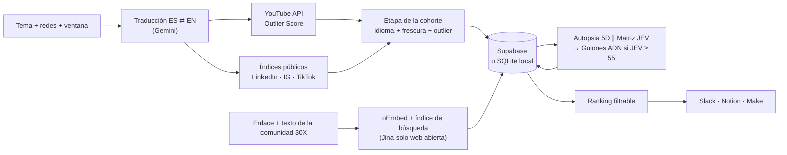

# 30X Trend Intelligence Engine

**Qué está despegando hoy en LinkedIn, Instagram, TikTok y YouTube, por qué funcionó, si le sirve a un ejecutivo de Latinoamérica y el guion listo para grabar en @andresbilbao y @30x.**

Construido para el equipo de Media de **30X**, la escuela de IA para líderes, fundadores y equipos de Latinoamérica.

---

## El problema

El equipo de contenido de 30X compite por la atención de ejecutivos que ya ven demasiada IA en su feed. Hoy, para saber qué publicar, alguien revisa redes a mano, intuye qué está funcionando, adivina por qué y lo reescribe en la voz de la marca. Eso cuesta horas, llega tarde y depende del olfato de una persona.

## La ecuación de valor

| Palanca | Antes | Con el motor |
|---|---|---|
| **Resultado** | Ideas sueltas | Guion de Reel y carrusel listos, en el ADN de 30X |
| **Probabilidad de acierto** | Intuición | Outlier Score real, etapa de la tendencia y score JEV con evidencia |
| **Tiempo de espera** | Días revisando feeds | Una búsqueda en vivo |
| **Esfuerzo** | Investigar, analizar, redactar | Copiar o enviar a Slack / Notion en un clic |

Es **el hueco, no el taladro**: el equipo no recibe un dashboard para interpretar, recibe la respuesta a las tres preguntas del reto para cada pieza.

| Pregunta del reto | Qué entrega el motor |
|---|---|
| **¿Qué está despegando y en qué etapa?** | Outlier Score (cuántas veces superó el promedio de su propio canal), velocidad, peso del autor y etapa 🌱 emergente · 🚀 despegando · 🔥 saturada, con las cifras que la justifican. |
| **¿Por qué funcionó?** | Autopsia de 5 variables: **Gancho, Formato, Tema, Momento y Autor vs. contenido**. |
| **Entregable: "¿cuáles son los 10 temas de IA que más crecen esta semana, por qué y cómo lo adaptamos?"** | El **Radar semanal** responde exactamente eso: agrupa las piezas en temas, mide cuántas salieron esta semana frente a la anterior y entrega el Top 10 con la autopsia y los guiones de la pieza que mejor representa cada tema. |
| **¿Le sirve a 30X y cómo lo adapto?** | Score JEV 0-100 para ejecutivos LatAm, Reel por segundos para @andresbilbao, carrusel por slides para @30x y ángulo contrarian obligatorio si el tema ya está saturado. |

---

## Recorrido de 2 minutos

1. Abre la app: la primera pantalla es **"Los 10 temas de IA que más crecen esta semana"**. Elige las redes (por ejemplo, solo LinkedIn) y pulsa **Actualizar radar** (2 a 4 minutos).
2. Cada tema muestra cuántas piezas salieron **esta semana frente a la anterior**, su etapa 🌱🚀🔥 y su JEV. Filtra por etapa para quedarte con los emergentes.
3. **Abre un tema**: por qué está creciendo, y la pieza que mejor lo representa con sus 5 variables, la Matriz JEV y el Reel y el carrusel listos para grabar.
4. **Envíalo** a Slack, Notion o Make con un clic.
5. ¿Tienes un tema concreto? Más abajo, "¿Qué está despegando sobre ___?" lo explora pieza por pieza, con filtros por red, etapa, JEV, outlier y formato.
6. ¿Alguien del equipo vio algo funcionando? Lo pega en el **Sensor de Comunidad**, con el texto si es de LinkedIn, Instagram o TikTok, y recibe la misma autopsia.

---

## Datos abiertos y cumplimiento de ToS

| Fuente | Para qué | Por qué es legal |
|---|---|---|
| **YouTube Data API v3** | Vistas, suscriptores y promedio del canal → Outlier Score | API oficial con clave propia |
| **Tavily** (Google Programmable Search como respaldo) | Publicaciones públicas indexadas de LinkedIn, Instagram y TikTok | Índices de búsqueda públicos: nunca se visita la red social |
| **oEmbed** (YouTube, TikTok, Instagram) | Metadatos de los enlaces que pega el equipo | Protocolo oficial de embebido |
| **Jina Reader** | Texto de artículos de la **web abierta** (blogs, medios, documentación) | Solo sitios públicos sin restricción. **Nunca** se usa sobre LinkedIn, Instagram ni TikTok |
| **Comunidad 30X** | Enlace + texto de la publicación que la persona vio y pega a mano | Es un humano compartiendo contenido público, no un robot |
| **Google Gemini 3.8 Flash** | Autopsia, JEV y guiones | Solo Structured Outputs validados |

**Nunca se usan** logins, cookies, cuentas de terceros, datos privados ni descargas de páginas de LinkedIn, Instagram o TikTok, ni directas ni a través de lectores o proxies de terceros: que lo haga otro servicio no lo vuelve legítimo. Cuando una red no expone una métrica de forma legal, el motor la deja vacía en lugar de inventarla.

**Nada de datos personales:** el motor analiza piezas, no personas. No guarda nombres, handles, perfiles ni miniaturas de autores, ni el nombre de quien envía un enlace. "Autor vs. contenido" se resuelve con cifras (seguidores, promedio, Outlier) sin identidad, y a Gemini no se le envía ningún nombre. Solo se conserva la URL pública de la pieza, necesaria para citarla.

**Políticas de YouTube API:** los datos de YouTube se borran si no se refrescan en 30 días, la interfaz atribuye los datos a YouTube y enlaza sus Términos y la Política de privacidad de Google, y las métricas propias (Outlier, velocidad, etapa, JEV) se presentan como cálculos de 30X, no como métricas de YouTube.

La auditoría completa, red por red, está en [`docs/ARCHITECTURE.md`](docs/ARCHITECTURE.md) (sección "Cumplimiento de reglas") y se verifica en cada `npm run smoke`.

---

## Cómo funciona



### Las métricas se calculan, no se adivinan

Gemini interpreta y redacta. Todo lo que es número lo calcula el código, de forma reproducible:

**Outlier Score (YouTube)**
```
outlier       = vistas del video / (vistas totales del canal / videos del canal)
author_weight = 1 − log10(outlier) / log10(50)        acotado a [0, 1]
```
×1 significa que el video rindió lo que el canal rinde siempre: lo explica la audiencia del autor. ×50 o más significa que el tema o el gancho multiplicó el rendimiento: el mérito es de la pieza. Ese mismo dato fija el veredicto "Autor vs. contenido" de la autopsia.

**Fecha de publicación en LinkedIn, TikTok e Instagram**: se decodifica del ID público de la URL (los IDs de estas redes llevan la hora de creación), así que es exacta aunque el buscador no la indexe.

**Etapa de la tendencia**: se mide sobre todas las piezas de la búsqueda, no sobre una sola.

| Etapa | Regla |
|---|---|
| 🌱 Emergente | Menos del 15 % en español y aceleración (≥ 40 % publicado en 72 h u outlier mediano ≥ ×3) |
| 🔥 Saturada | 40 % o más en español y volumen alto (≥ 15 piezas) o ya sin frescura |
| 🚀 Despegando | Todo lo demás: hay tracción y todavía hay hueco en español |

**Matriz JEV**: Gemini puntúa tres criterios y el código aplica los pesos.
```
JEV = 0.40 · impacto en negocio + 0.35 · aplicabilidad sin un equipo de 20 ingenieros + 0.25 · claridad ejecutiva
```

**Prioridad del Top 10**: `0.5 · JEV + 0.3 · outlier normalizado + 0.2 · peso de la etapa` (despegando 100, emergente 80, saturada 30).

### Radar semanal: cómo se mide el crecimiento

Cada semilla (pares español + inglés en el ADN de marca) se busca con una ventana de **14 días**. Como la fecha de cada pieza es exacta, una sola búsqueda alcanza para contar **esta semana frente a la anterior**. Gemini agrupa las piezas en temas concretos en una sola llamada, y el código mide cada tema:

```
crecimiento = 50 + 30 · log2((piezas esta semana + 1) / (piezas semana anterior + 1))     (0-100; 50 = estable)
puntaje     = 0.5 · crecimiento + 0.2 · volumen + 0.3 · JEV de su pieza más representativa
```

Un tema que pasa de 2 a 8 piezas obtiene un crecimiento de ≈ 97. Si no cambia, se queda en 50.

### Cuánto cuesta (y por qué no es una fortuna)

| Por corrida del Radar (4 redes, 8 semillas) | Consumo | Plan gratuito |
|---|---|---|
| YouTube Data API | ≈ 816 unidades | 10.000 al día |
| Tavily (profundidad `basic`) | ≈ 24 créditos | créditos mensuales gratuitos |
| Gemini 3.8 Flash | **3 solicitudes** (1 de agrupación + 2 de análisis en lote) | 20 solicitudes al día → unas 6 corridas |

Las piezas ya analizadas no se vuelven a pagar. Frente a los servicios de scraping de miles de dólares al año, el costo operativo de una corrida semanal cabe en los planes gratuitos.

### El ADN de marca es configuración, no código

Las reglas de voz de @andresbilbao, el formato de carrusel de @30x y la Matriz JEV viven en [`docs/30X_BRAND_DNA.md`](docs/30X_BRAND_DNA.md). El motor lo lee en cada análisis y el equipo puede editarlo desde **Conexiones** en la interfaz. El siguiente guion ya sale con la regla nueva.

---

## Plug & Play con el ecosistema 30X

| Destino | Qué llega | Configuración |
|---|---|---|
| **Slack** | Mensaje con etapa, JEV, outlier, las 5 variables, gancho del Reel y botón a la pieza | Incoming Webhook en `SLACK_WEBHOOK_URL` |
| **Notion** | Página en la base de contenidos con la autopsia, el desglose JEV y los dos guiones | `NOTION_API_KEY` + `NOTION_DATABASE_ID`. No hay que renombrar columnas: el conector lee la base y llena `Red`, `Etapa`, `Formato`, `JEV`, `Outlier`, `URL` y `Publicado` si existen |
| **Make / Zapier** | La tendencia completa en JSON | `MAKE_WEBHOOK_URL` |
| **Entrada desde Slack o Make** | Cualquier enlace que el equipo comparta | Webhook a `POST /api/analyze-url` con `Authorization: Bearer $INGEST_WEBHOOK_SECRET` |

Cada persona también puede pegar sus propios webhooks en **Conexiones**: se guardan solo en su navegador y, por seguridad, solo se aceptan dominios oficiales de Slack y Make.

---

## Levantar el entorno en 2 minutos

Requisitos: **Node.js 22.13 o superior**.

```bash
npm install
```

```bash
cp .env.example .env.local
```

Completa en `.env.local` las claves que tengas. **Ninguna es obligatoria para arrancar**: cada fuente sin clave se desactiva y la interfaz dice cuál falta.

| Variable | Desbloquea | Dónde se obtiene |
|---|---|---|
| `GEMINI_API_KEY` | Autopsia, JEV, guiones y búsqueda bilingüe | aistudio.google.com |
| `YOUTUBE_API_KEY` | Outliers de YouTube | Google Cloud Console → YouTube Data API v3 |
| `TAVILY_API_KEY` | LinkedIn, Instagram y TikTok | app.tavily.com |
| `SUPABASE_URL` + `SUPABASE_SERVICE_ROLE_KEY` | Base en la nube (si faltan, SQLite local en `.data/`) | supabase.com |

**Para operar con datos reales lo mínimo es Gemini + YouTube o Tavily.** Las tres tienen plan gratuito:

1. **Gemini**: entra a aistudio.google.com con tu cuenta de Google → *Get API key* → pégala en `GEMINI_API_KEY`.
2. **YouTube**: en console.cloud.google.com crea un proyecto → *APIs y servicios* → habilita **YouTube Data API v3** → *Credenciales* → *Crear clave de API* → `YOUTUBE_API_KEY` (10.000 unidades diarias gratis, unas 95 búsquedas).
3. **Tavily**: crea tu cuenta en app.tavily.com y copia la clave del panel → `TAVILY_API_KEY`.

Las claves van **solo** en `.env.local`, que git ignora. Comprueba que funcionan sin abrir la app:

```bash
npm run doctor
```

El diagnóstico prueba cada clave contra el servicio real con la llamada más barata posible y te dice cuál falta o qué error devolvió el proveedor, sin mostrar nunca las claves.

Si usas Supabase, aplica la migración [`supabase/migrations/001_trend_signals.sql`](supabase/migrations/001_trend_signals.sql) desde el SQL Editor o con `supabase db push`.

```bash
npm run dev
```

Abre http://localhost:3000.

Para verificar todo de una vez (tipos, prueba de humo y build de producción). No gasta cuota: las llamadas reales a YouTube, Tavily y Gemini solo corren con `SMOKE_LIVE=1`.

```bash
npm run check
```

---

## API

| Endpoint | Para qué |
|---|---|
| `POST /api/radar` | Ejecuta el Radar semanal: Top 10 de temas que más crecen, con porqué y adaptación |
| `GET /api/radar` | Último radar guardado (o `?run=<id>`) |
| `POST /api/discover` | Busca en vivo (con variante en el otro idioma), guarda y analiza el Top N |
| `GET /api/discover` | Filtra lo guardado: red, etapa, formato, idioma, estado, ventana, JEV, outlier, texto y orden |
| `POST /api/analyze-url` | Sensor de Comunidad (`url`) o re-análisis de una pieza guardada (`id`) |
| `POST /api/export-30x` | Envía una tendencia a Slack, Notion y/o Make |
| `GET /api/status` | Qué fuentes y destinos están conectados (sin exponer claves) |
| `GET \| PUT /api/brand-dna` | Lee y edita el ADN de marca |

```bash
curl -X POST http://localhost:3000/api/discover -H "Content-Type: application/json" -d '{"query":"agentes de IA para ventas","networks":["youtube","linkedin"],"windowDays":7}'
```

Contratos completos, ejemplos de respuesta y códigos de error: [`docs/API_CONTRACTS.md`](docs/API_CONTRACTS.md).

---

## Calidad y verificación

| Qué | Resultado |
|---|---|
| TypeScript estricto (`strict` + `noUncheckedIndexedAccess`) | Sin errores |
| `next build` de producción | Sin errores ni avisos |
| `npm audit` | 0 vulnerabilidades |
| Prueba de humo (`npm run smoke`) | Crecimiento semanal por tema, privacidad (incluida la limpieza de bases antiguas), persistencia del radar, fórmulas, fechas desde IDs, etapas, filtros SQLite, payloads de Slack y Notion, anti-SSRF y degradación sin claves |
| Migraciones SQL (001-003) | Aplicadas en secuencia en PostgreSQL 17 real (PGlite): idempotentes, sin columnas de identidad tras 002, radar con CHECKs, cascada y `representative_id` → null al purgar, CHECKs, upsert que preserva análisis, búsqueda de texto y uso de índices |
| Endpoints en vivo | Códigos 200 / 400 / 401 / 404 / 503 según contrato, deduplicación de URLs, webhook real a Slack |
| Interfaz | Revisada en navegador, de escritorio a 375 px sin scroll horizontal; foco visible y `prefers-reduced-motion` |

**Validado con claves reales (YouTube + Gemini)**: corridas completas del Radar semanal sobre 96 piezas de YouTube, 9-10 temas, autopsias, JEV y guiones en 3 solicitudes, sin datos de identidad en la salida. **Pendiente**: ingesta de Tavily (LinkedIn, Instagram, TikTok), análisis de Gemini de punta a punta y la creación de páginas en Notion. El código y los contratos están listos; solo falta conectar las credenciales.

### Límites conocidos (y cómo se manejan)

- LinkedIn, Instagram y TikTok no publican vistas por vías legales: para esas redes el outlier queda vacío y la prioridad se apoya en JEV, etapa y recencia.
- La etapa de un enlace suelto del Sensor es provisional, porque no hay otras piezas del mismo tema con las cuales compararlo.
- En LinkedIn, Instagram y TikTok el Sensor solo cuenta con oEmbed, lo que el buscador tenga indexado y el texto que pegue la persona. Si una publicación no está indexada, pegar su texto da el análisis más completo.
- No hay login de usuarios: se recomienda desplegar en red privada o detrás de la protección del hosting.

Detalle técnico y decisiones de diseño: [`docs/ARCHITECTURE.md`](docs/ARCHITECTURE.md) · Historial: [`docs/CHANGELOG.md`](docs/CHANGELOG.md).

---

## Estructura

```
src/
├── app/
│   ├── page.tsx                  Buscador, filtros y ranking
│   └── api/                      discover · analyze-url · export-30x · status · brand-dna
├── components/                   ControlBar · TrendCard · CommunitySensor · PlugAndPlayConfig
├── lib/
│   ├── sources/                  youtube-outliers · social-serp · public-reader
│   ├── radar.ts                  Radar semanal (semillas → temas → crecimiento → análisis)
│   ├── privacy.ts                Minimización de datos personales
│   ├── intelligence/             trend-stage · topic-clusterer · topic-growth · forensic-5d · jev-scorer · bilbao-adapter · query-expander
│   ├── export/                   slack · notion · make
│   └── db/supabase.ts            Supabase o SQLite con la misma interfaz
└── types/trends.ts               Contratos estrictos
supabase/migrations/              Esquema Postgres con índices por filtro
docs/                             Arquitectura, contratos, ADN de marca y changelog
```

**Stack**: Next.js 16 (App Router) · TypeScript estricto · Tailwind CSS 4 · Lucide · Supabase / SQLite nativo · Google Gemini 3.8 Flash (`@google/genai`, Structured Outputs) · Zod.
