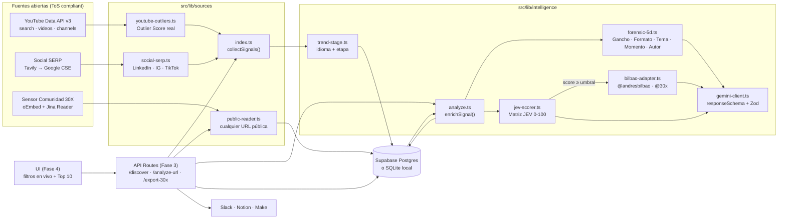
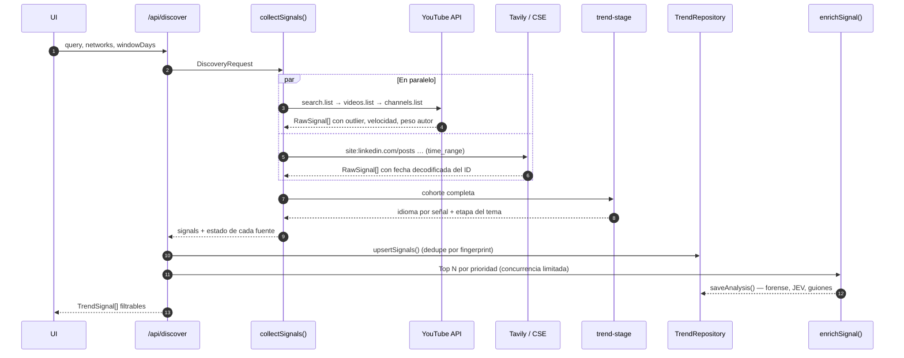
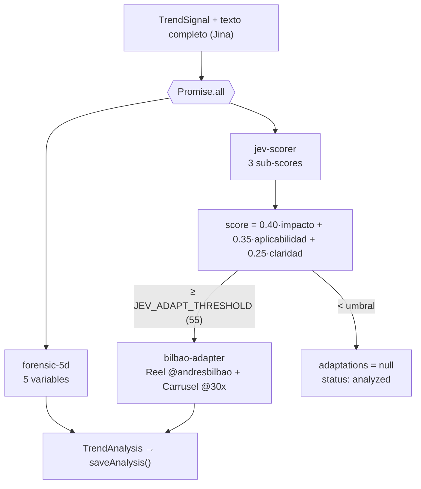
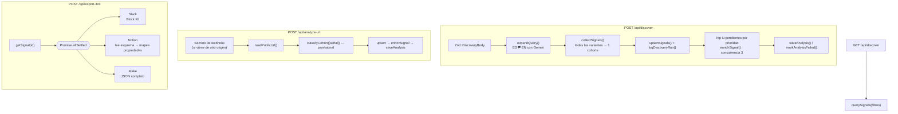
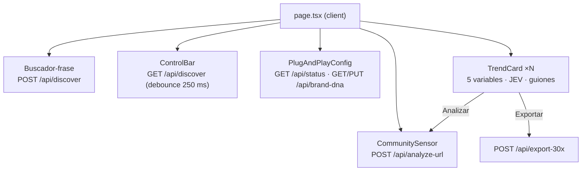
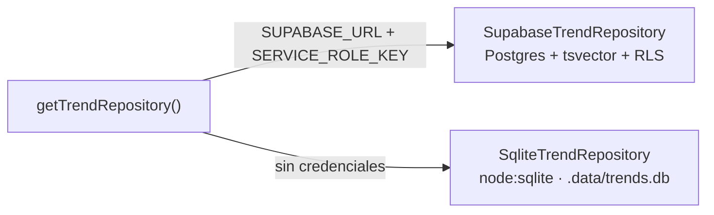

# Arquitectura — 30X Trend Intelligence Engine

> Documento vivo. Se actualiza antes de construir cada módulo nuevo (regla §5 de `CLAUDE.md`).
> Última actualización: 2026-10-17 · Fases 1 a 4.

## 1. Principios de diseño

| Principio | Decisión técnica |
|---|---|
| **Vender el Hueco, no el Taladro** | Cada señal sale del backend con las 3 respuestas del reto ya resueltas: etapa de la tendencia, autopsia 5D y guiones adaptados. La UI solo filtra y exporta. |
| **Cero contenido hardcoded** | Todo tema nace de una consulta real a una API pública, se persiste y se filtra por SQL. No hay seeds ni mocks en el código de producción. |
| **100 % ToS compliant** | Solo APIs oficiales (YouTube Data API v3), índices de búsqueda públicos (Tavily / Google Programmable Search), `oEmbed` y lectores de URL pública (Jina Reader). Nunca logins, cookies ni scraping directo de Meta / LinkedIn / TikTok. |
| **Nunca falla en local** | Si no hay credenciales de Supabase, el repositorio cae automáticamente a SQLite nativo (`node:sqlite`). Si falta la clave de una fuente, esa fuente se marca `disabled` y las demás siguen. |
| **IA explicable** | Las métricas duras (Outlier Score, velocidad, peso del autor, etapa) se calculan de forma determinista en TypeScript. Gemini solo interpreta y redacta, siempre con `responseSchema` y validación Zod. |

## 2. Vista general



## 3. Flujo de ingesta (`/api/discover`)



Cada fuente devuelve un `SourceReport` (`ok` · `disabled` · `error`) para que el usuario sepa qué datos faltan y por qué, sin que la búsqueda completa falle.

## 4. Cálculos deterministas

### 4.1 Outlier Score (YouTube)

```
avg_views_canal = channel.viewCount / max(channel.videoCount, 1)
outlier_score   = video.views / max(avg_views_canal, 1)
subs_ratio      = video.views / max(channel.subscriberCount, 1)
velocity        = video.views / horas_desde_publicación
author_weight   = clamp(1 − log10(max(outlier, 1)) / log10(50), 0, 1)
```

- `outlier_score = 1` → la pieza rindió lo que el canal rinde siempre: el éxito se explica por la audiencia del autor (`author_weight = 1`).
- `outlier_score ≥ 50` → el tema/gancho multiplicó ×50 el promedio del canal: el mérito es de la pieza (`author_weight = 0`).
- Limitación conocida: `viewCount / videoCount` es el promedio histórico del canal. Es la mejor aproximación disponible con cuota baja (1 unidad por lote de 50 canales).

**Shorts vs. largos:** `duration ≤ 180 s` o `#shorts` en título/descripción ⇒ `short_vertical`.

**Cuota YouTube por búsqueda:** 100 (search) + 1 (videos, ≤ 50 ids) + 1 (channels, ≤ 50 ids) ≈ **102 unidades** con `youtubeFormat = any | short`; `long` hace dos búsquedas (`medium` + `long`) ≈ 202. Con la cuota gratuita (10.000/día) caben ~95 búsquedas diarias.

### 4.2 Señales SERP (LinkedIn / Instagram / TikTok)

Las redes cerradas no exponen vistas vía índices públicos. Se reconstruye todo lo posible de forma legal:

| Dato | Cómo se obtiene |
|---|---|
| Fecha de publicación | **Decodificada del ID público de la URL**: LinkedIn `activity:<id>` → `id >> 22` ms; TikTok `/video/<id>` → `id >> 32` s; Instagram shortcode → media id → `(id >> 23) + 1314220021721` ms. Fallback: `published_date` del índice. |
| Autor | Path de la URL (`/posts/<handle>_…`, `/@<handle>/video/…`) o título indexado. |
| Engagement | Parser de cifras en el snippet indexado (`1,2 K reacciones`, `3.4M views`, `56 comments`, `Me gusta`). `null` si no aparece. |
| Formato | Path (`/reel/`, `/p/`, `/pulse/`, `/video/`). |

Como no hay promedio del canal, `outlier_score` queda `null` para SERP y la prioridad se apoya en JEV + etapa + recencia.

### 4.3 Etapa de la tendencia (`trend-stage.ts`)

Se evalúa sobre la **cohorte** de resultados de una misma consulta:

```
es_share     = señales en español / señales con idioma detectado
fresh_share  = señales publicadas en las últimas 72 h / total
median_outl  = mediana de outlier_score (si hay datos de YouTube)
```

| Etapa | Regla |
|---|---|
| `saturated` 🔥 | `es_share ≥ 0.40` **y** (`total ≥ 15` **o** `fresh_share < 0.25`) — ya lo copió todo el mercado hispano. |
| `emerging` 🌱 | `es_share < 0.15` **y** (`fresh_share ≥ 0.40` **o** `median_outl ≥ 3`) — acelera en inglés, casi nulo en español. |
| `peaking` 🚀 | Cualquier otro caso: hay tracción y todavía hay hueco en español. |

`stage_score` (0-100) refleja la confianza de la regla y se guarda junto a las métricas que la justifican (`stage_evidence`).

Detección de idioma: heurística de *stopwords* es / en / pt (sin dependencias, < 1 ms por texto). Si YouTube declara `defaultAudioLanguage`, tiene prioridad.

### 4.4 Prioridad (orden del Top 10)

```
priority = 0.50 · jev_score
         + 0.30 · min(outlier_score, 20) / 20 · 100   (si es null → 50)
         (jev_score aún sin analizar → 50 provisional)
         + 0.20 · peso_etapa                           (emerging 80 · peaking 100 · saturated 30)
```

Se recalcula al guardar el análisis y se indexa para ordenar sin cálculo en consulta.

## 5. Cerebro de IA



- Modelo: `gemini-2.5-flash` (configurable con `GEMINI_MODEL`).
- Todas las llamadas usan `responseMimeType: application/json` + `responseSchema`; la respuesta se valida con Zod y se reintenta una vez si no cumple.
- El score JEV final **no lo decide el modelo**: el modelo puntúa cada criterio y TypeScript aplica la ponderación documentada en `30X_BRAND_DNA.md`.
- El adaptador lee `docs/30X_BRAND_DNA.md` en tiempo de ejecución: el equipo puede editar el ADN sin tocar código.
- Si la etapa es `saturated`, el adaptador está obligado a devolver un `contrarian_angle`.

## 6. API Routes y Plug & Play (Fase 3)



- **Errores uniformes** (`src/lib/api.ts`): cada clase de error se traduce a un código HTTP y un `code` estable que la UI puede mostrar.
- **Exportación tolerante a fallos:** cada destino se ejecuta de forma independiente; uno caído no bloquea a los demás.
- **Notion plug & play:** no exige nombres de columnas fijos; se lee el esquema de la base y se llenan solo las propiedades compatibles.
- **Overrides seguros:** la configuración de webhooks enviada desde la UI solo acepta dominios oficiales de Slack y Make.
- **Duración:** las rutas que llaman a Gemini declaran `maxDuration = 120` s.

## 7. Interfaz (Fase 4)



- **Fuente de verdad = la base.** La UI nunca guarda tendencias en el navegador: tras descubrir o analizar, vuelve a pedir `GET /api/discover` con los filtros activos.
- **Filtros en la URL** (`?stages=emerging&minJev=70…`): una vista filtrada se comparte copiando el enlace.
- **Configuración por navegador:** los webhooks que el usuario pega en Plug & Play se guardan en `localStorage` y viajan como `overrides` al exportar; las variables de entorno siguen siendo el valor por defecto. `/api/status` dice qué está configurado en el servidor sin exponer secretos.
- **ADN editable:** `PUT /api/brand-dna` reescribe `docs/30X_BRAND_DNA.md` cuando el disco es escribible (local); en hosting de solo lectura responde `409` y la UI lo explica.
- **Diseño:** paleta oficial 30X, una sola familia tipográfica (Archivo, con eje de anchura para cifras), ranking numerado porque el Top 10 es un orden real; el multiplicador de Outlier y el termómetro de etapa son el único elemento enfático.

## 7b. Persistencia



- Una sola interfaz `TrendRepository` (`src/lib/db/supabase.ts`); las API Routes no saben qué motor hay debajo.
- **Dedupe:** `fingerprint = sha256(url canónica)`; el upsert solo actualiza columnas de ingesta, nunca borra un análisis previo.
- **Filtros dinámicos** soportados en ambos motores: red, etapa, formato, ventana de fecha, rango JEV, outlier mínimo, idioma, estado de análisis, texto libre y orden (`priority`, `jev`, `outlier`, `recent`, `velocity`).
- Esquema: `supabase/migrations/001_trend_signals.sql` (índices compuestos por cada filtro de la `ControlBar`).
- SQLite usa el `node:sqlite` nativo de Node ≥ 22.13 en vez de Prisma/Drizzle: cero binarios nativos que compilar en Windows y cero paso de generación, que es lo que exige "nunca falle en local".

## 7c. Diagnóstico de conexiones (`npm run doctor`)

`scripts/doctor.ts` lee `.env.local` y prueba cada servicio con la llamada **más barata posible** contra la API real, sin escribir datos:

| Servicio | Prueba | Costo |
|---|---|---|
| Gemini | `models.get` del modelo configurado | 0 tokens |
| YouTube Data API | `videos.list` de un video público | 1 unidad de cuota |
| Tavily | búsqueda `basic` de 1 resultado | 1 crédito |
| Google CSE | consulta de 1 resultado | 1 consulta |
| Jina Reader | lectura de `https://example.com` | mínima |
| Supabase | `count` sobre `trend_signals` (confirma que la migración está aplicada) | 0 |
| Notion | lectura del esquema de la base | 0 |
| Slack / Make | solo formato de la URL (probarlos enviaría un mensaje real) | 0 |

Nunca imprime valores de claves: solo `OK`, `FALTA` o el error del proveedor. Sale con código 1 si falla algo **mínimo** para operar (Gemini + al menos una fuente de descubrimiento).

## 8. Limitaciones conocidas

- **Jina Reader anónimo** puede bloquear dominios muy consultados (verificado: `youtube.com` devolvió 403 sin clave). Para YouTube no importa porque el sensor usa la YouTube API + oEmbed; para LinkedIn conviene configurar `JINA_API_KEY`.
- **Google Programmable Search JSON API**: Google la cerró a clientes nuevos y anunció su retiro; por eso Tavily es el proveedor principal y CSE solo un respaldo para quien ya tenga clave.
- **Etapa `emerging`** depende de que la cohorte mezcle idiomas. Mitigado en Fase 3: `/api/discover` traduce la consulta y busca también en inglés (`bilingual: true`, requiere Gemini). Sin Gemini, la cohorte queda en el idioma de la consulta y la etapa puede sesgarse.
- **Etapa de una URL aislada** (Sensor de Comunidad) es provisional: cohorte de 1.
- **Secreto de webhooks**: la excepción de mismo origen se basa en la cabecera `Origin`, que un cliente no-navegador puede falsificar. Es una barrera contra llamadas casuales, no autenticación de usuarios; para exponerlo en internet hace falta login (fuera del alcance del hackathon).
- **Costo de YouTube con `bilingual`**: duplica la cuota (≈ 204 unidades por búsqueda). Se limita a una sola variante extra para no triplicarla.
- **Sin autenticación de usuarios**: `/api/discover` y `/api/export-30x` quedan abiertos a quien llegue a la URL y pueden consumir cuota. Para el hackathon se despliega en red privada o detrás de la protección del hosting (p. ej. Vercel Deployment Protection).
- **Enlaces externos**: solo se guardan y renderizan URLs http(s) (las de índices SERP, solo `https://`); React escapa todo el texto de terceros.
- **Outlier en SERP**: sin promedio del autor no se calcula (queda `null`), por diseño, para no inventar métricas.

## 9. Decisiones registradas (ADR corto)

| # | Decisión | Motivo |
|---|---|---|
| 1 | `node:sqlite` en lugar de Prisma/Drizzle para el fallback | Sin dependencias nativas ni `prisma generate`; arranca en 2 min en cualquier máquina con Node 22+. |
| 2 | Tavily como SERP principal, Google CSE como respaldo | Tavily filtra por dominio y ventana temporal en una llamada; CSE cubre si no hay clave de Tavily. |
| 3 | Fecha de publicación desde el ID de la URL | Dato exacto, público y legal; los índices a menudo no traen la fecha. |
| 4 | Score JEV ponderado en código, no por el LLM | Reproducible y auditable para el jurado; el LLM solo argumenta cada criterio. |
| 5 | Adaptación solo si JEV ≥ umbral | Ahorra ~1/3 del costo de IA en piezas que no sirven a la audiencia LatAm. |
| 6 | Jina Reader para el Sensor de Comunidad | Jina hace el fetch desde su infraestructura y respeta `robots`; nuestro servidor nunca toca la red social directamente. |
| 7 | Búsqueda bilingüe por defecto | La etapa `emerging` necesita comparar inglés vs. español; una sola consulta en español no puede detectarla. |
| 8 | Notion por descubrimiento de esquema | Cada equipo tiene su propia base de contenidos; exigir columnas fijas rompe el plug & play. |
