# Arquitectura — Lunes AI (30X Trend Intelligence Engine)

> Documento vivo. Se actualiza antes de construir cada módulo nuevo (regla §5 de `CLAUDE.md`).
> Última actualización: 2026-10-17 · Fases 1 a 4.

## 1. Principios de diseño

| Principio | Decisión técnica |
|---|---|
| **Vender el Hueco, no el Taladro** | Cada señal sale del backend con las 3 respuestas del reto ya resueltas: etapa de la tendencia, autopsia 5D y guiones adaptados. La UI solo filtra y exporta. |
| **Cero contenido hardcoded** | Todo tema nace de una consulta real a una API pública, se persiste y se filtra por SQL. No hay seeds ni mocks en el código de producción. |
| **100 % ToS compliant** | Solo APIs oficiales (YouTube Data API v3), índices de búsqueda públicos (Tavily / Google Programmable Search), `oEmbed` y lectores de URL pública (Jina Reader). Nunca logins, cookies ni scraping directo de Meta / LinkedIn / TikTok. |
| **Nunca falla en local** | Si no hay credenciales de Supabase, el repositorio cae automáticamente a SQLite nativo (`node:sqlite`). Si falta la clave de una fuente, esa fuente se marca `disabled` y las demás siguen. |
| **IA explicable** | Las métricas duras (Outlier Score, velocidad, peso del autor, etapa) se calculan de forma determinista en TypeScript. Gemini solo interpreta y redacta, siempre con `responseSchema` y validación Zod. |

## 2. Vista general

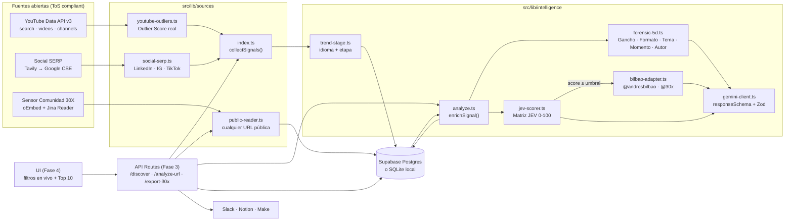

## 3. Flujo de ingesta (`/api/discover`)

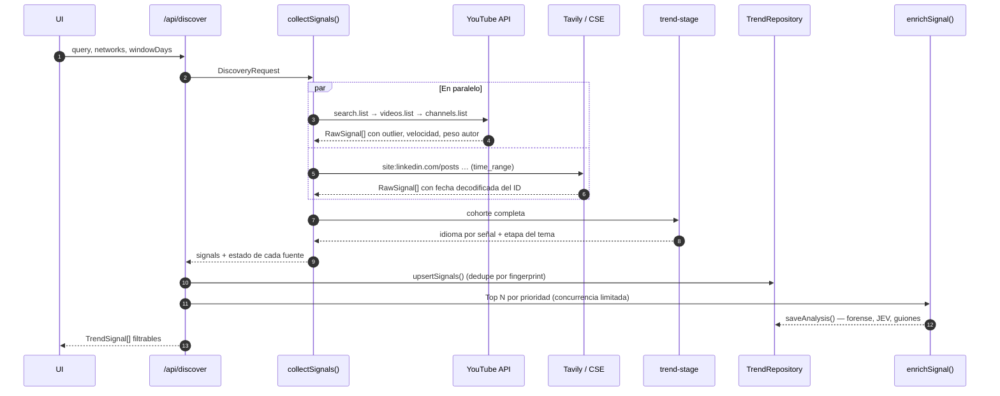

Cada fuente devuelve un `SourceReport` (`ok` · `disabled` · `error`) para que el usuario sepa qué datos faltan y por qué, sin que la búsqueda completa falle.

## 4. Cálculos deterministas

### 4.1 Outlier Score (YouTube)

```
avg_views_canal = channel.viewCount / max(channel.videoCount, 1)
outlier_score   = video.views / max(avg_views_canal, 1)
subs_ratio      = video.views / max(channel.subscriberCount, 1)
velocity        = video.views / horas_desde_publicación
author_weight   = clamp(1 − log10(max(outlier, 1)) / log10(50), 0, 1)
```

- `outlier_score = 1` → la pieza rindió lo que el canal rinde siempre: el éxito se explica por la audiencia del autor (`author_weight = 1`).
- `outlier_score ≥ 50` → el tema/gancho multiplicó ×50 el promedio del canal: el mérito es de la pieza (`author_weight = 0`).
- Limitación conocida: `viewCount / videoCount` es el promedio histórico del canal. Es la mejor aproximación disponible con cuota baja (1 unidad por lote de 50 canales).

**Shorts vs. largos:** `duration ≤ 180 s` o `#shorts` en título/descripción ⇒ `short_vertical`.

**Cuota YouTube por búsqueda:** 100 (search) + 1 (videos, ≤ 50 ids) + 1 (channels, ≤ 50 ids) ≈ **102 unidades** con `youtubeFormat = any | short`; `long` hace dos búsquedas (`medium` + `long`) ≈ 202. Con la cuota gratuita (10.000/día) caben ~95 búsquedas diarias.

### 4.2 Señales SERP (LinkedIn / Instagram / TikTok)

Las redes cerradas no exponen vistas vía índices públicos. Se reconstruye todo lo posible de forma legal:

| Dato | Cómo se obtiene |
|---|---|
| Fecha de publicación | **Decodificada del ID público de la URL**: LinkedIn `activity:<id>` → `id >> 22` ms; TikTok `/video/<id>` → `id >> 32` s; Instagram shortcode → media id → `(id >> 23) + 1314220021721` ms. Fallback: `published_date` del índice. |
| Autor | Path de la URL (`/posts/<handle>_…`, `/@<handle>/video/…`) o título indexado. |
| Engagement | Parser de cifras en el snippet indexado (`1,2 K reacciones`, `3.4M views`, `56 comments`, `Me gusta`). `null` si no aparece. |
| Formato | Path (`/reel/`, `/p/`, `/pulse/`, `/video/`). |

Como no hay promedio del canal, `outlier_score` queda `null` para SERP y la prioridad se apoya en JEV + etapa + recencia.

### 4.3 Etapa de la tendencia (`trend-stage.ts`)

Se evalúa sobre la **cohorte** de resultados de una misma consulta:

```
es_share     = señales en español / señales con idioma detectado
fresh_share  = señales publicadas en las últimas 72 h / total
median_outl  = mediana de outlier_score (si hay datos de YouTube)
```

| Etapa | Regla |
|---|---|
| `saturated` 🔥 | `es_share ≥ 0.40` **y** (`total ≥ 15` **o** `fresh_share < 0.25`) — ya lo copió todo el mercado hispano. |
| `emerging` 🌱 | `es_share < 0.15` **y** (`fresh_share ≥ 0.40` **o** `median_outl ≥ 3`) — acelera en inglés, casi nulo en español. |
| `peaking` 🚀 | Cualquier otro caso: hay tracción y todavía hay hueco en español. |

`stage_score` (0-100) refleja la confianza de la regla y se guarda junto a las métricas que la justifican (`stage_evidence`).

Detección de idioma: heurística de *stopwords* es / en / pt (sin dependencias, < 1 ms por texto). Si YouTube declara `defaultAudioLanguage`, tiene prioridad.

### 4.4 Prioridad (orden del Top 10)

```
priority = 0.50 · jev_score
         + 0.30 · min(outlier_score, 20) / 20 · 100   (si es null → 50)
         (jev_score aún sin analizar → 50 provisional)
         + 0.20 · peso_etapa                           (emerging 80 · peaking 100 · saturated 30)
```

Se recalcula al guardar el análisis y se indexa para ordenar sin cálculo en consulta.

## 5. Cerebro de IA

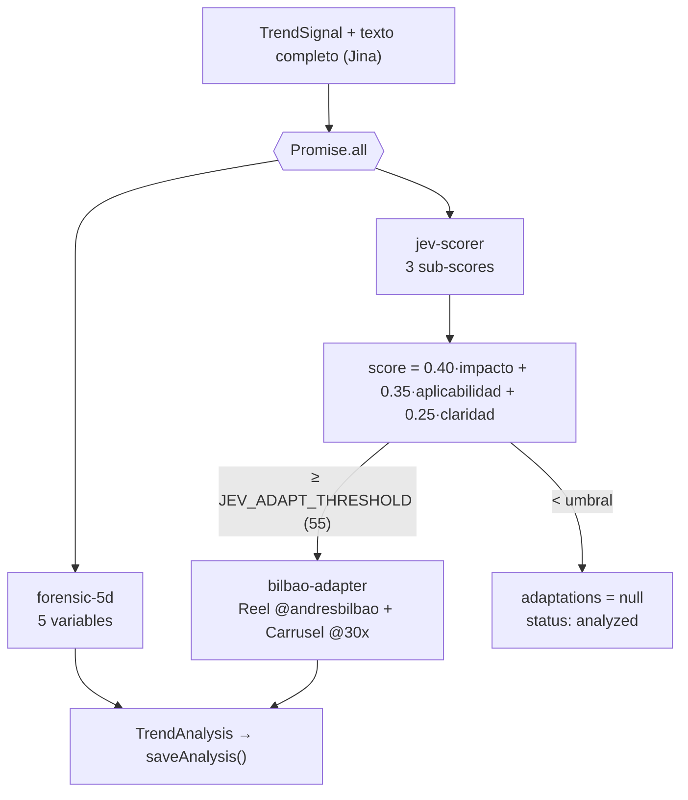

- Modelo: `gemini-3.8-flash` (configurable con `GEMINI_MODEL`). Ver ADR 9.
- Todas las llamadas usan `responseMimeType: application/json` + `responseSchema`; la respuesta se valida con Zod y se reintenta una vez si no cumple.
- El score JEV final **no lo decide el modelo**: el modelo puntúa cada criterio y TypeScript aplica la ponderación documentada en `30X_BRAND_DNA.md`.
- El adaptador lee `docs/30X_BRAND_DNA.md` en tiempo de ejecución: el equipo puede editar el ADN sin tocar código.
- Si la etapa es `saturated`, el adaptador está obligado a devolver un `contrarian_angle`.

### 5.1 Análisis en lote (cuota de Gemini)

Verificado con una cuenta real: el plan gratuito de `gemini-3.8-flash` permite **20 solicitudes al día**. Analizar pieza por pieza (forense + JEV + guiones = 3 llamadas) hacía que un radar de 10 temas necesitara ~30. Por eso el cerebro trabaja **en lote**:

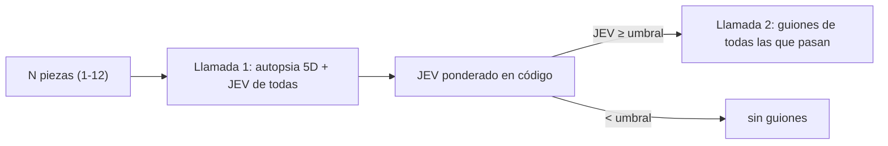

| Flujo | Solicitudes a Gemini |
|---|---|
| Radar semanal (10 temas) | 1 agrupación + 2 de análisis = **3** |
| Búsqueda por tema (Top 5) | 1 traducción + 2 = **3** |
| Sensor / "Analizar con IA" (1 pieza) | **2** |

Con 20 solicitudes diarias alcanzan para unas 6 corridas del radar al día. Ante "alta demanda" (503) o el límite por minuto (429) se reintenta con espera; si la cuota **diaria** se agotó, se responde de inmediato con el tiempo de renovación, sin reintentos inútiles.

## 6. API Routes y Plug & Play (Fase 3)

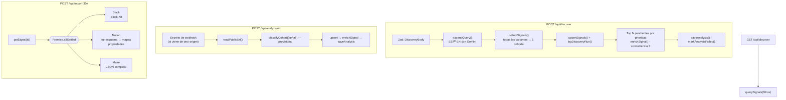

- **Errores uniformes** (`src/lib/api.ts`): cada clase de error se traduce a un código HTTP y un `code` estable que la UI puede mostrar.
- **Exportación tolerante a fallos:** cada destino se ejecuta de forma independiente; uno caído no bloquea a los demás.
- **Notion plug & play:** no exige nombres de columnas fijos; se lee el esquema de la base y se llenan solo las propiedades compatibles.
- **Overrides seguros:** la configuración de webhooks enviada desde la UI solo acepta dominios oficiales de Slack y Make.
- **Duración:** las rutas que llaman a Gemini declaran `maxDuration = 120` s.

## 7. Interfaz (Fase 4)

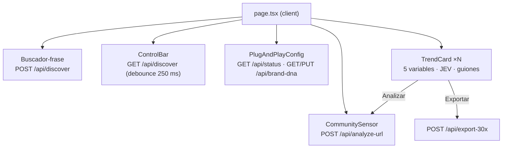

- **Fuente de verdad = la base.** La UI nunca guarda tendencias en el navegador: tras descubrir o analizar, vuelve a pedir `GET /api/discover` con los filtros activos.
- **Filtros en la URL** (`?stages=emerging&minJev=70…`): una vista filtrada se comparte copiando el enlace.
- **Configuración por navegador:** los webhooks que el usuario pega en Plug & Play se guardan en `localStorage` y viajan como `overrides` al exportar; las variables de entorno siguen siendo el valor por defecto. `/api/status` dice qué está configurado en el servidor sin exponer secretos.
- **ADN editable:** `PUT /api/brand-dna` reescribe `docs/30X_BRAND_DNA.md` cuando el disco es escribible (local); en hosting de solo lectura responde `409` y la UI lo explica.
- **Diseño:** paleta oficial 30X, una sola familia tipográfica (Archivo, con eje de anchura para cifras), ranking numerado porque el Top 10 es un orden real; el multiplicador de Outlier y el termómetro de etapa son el único elemento enfático.

## 7b. Persistencia

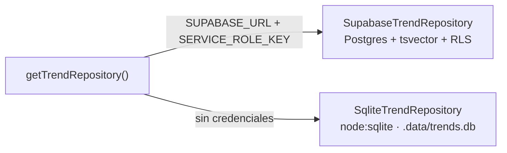

- Una sola interfaz `TrendRepository` (`src/lib/db/supabase.ts`); las API Routes no saben qué motor hay debajo.
- **Dedupe:** `fingerprint = sha256(url canónica)`; el upsert solo actualiza columnas de ingesta, nunca borra un análisis previo.
- **Filtros dinámicos** soportados en ambos motores: red, etapa, formato, ventana de fecha, rango JEV, outlier mínimo, idioma, estado de análisis, texto libre y orden (`priority`, `jev`, `outlier`, `recent`, `velocity`).
- Esquema: `supabase/migrations/001_trend_signals.sql` (índices compuestos por cada filtro de la `ControlBar`).
- **Publicación** (`docs/DEPLOY.md`): Vercel + Supabase. `supabase/setup.sql` reúne las migraciones 001-004 en un solo archivo idempotente para pegar en el SQL Editor; `npm run db:push` (`scripts/db-push.ts`) copia la base SQLite local (perfiles, piezas, análisis, radares, vistas) a Supabase por `id`, sin llamar a la IA, para publicar con el radar ya preparado. En Vercel sin Supabase, el fallback SQLite escribe en `/tmp` (efímero) para que la app arranque igual.
- SQLite usa el `node:sqlite` nativo de Node ≥ 22.13 en vez de Prisma/Drizzle: cero binarios nativos que compilar en Windows y cero paso de generación, que es lo que exige "nunca falle en local".

## 7b-bis. Cumplimiento de reglas (auditoría 2026-10-17)

Regla del reto: entra cualquier enfoque para descubrir y entender contenido público; no entran datos privados, contenido detrás de un login de terceros ni técnicas que dependan de violar términos de servicio.

| Red / fuente | Qué se usa | Qué NO se usa |
|---|---|---|
| YouTube | YouTube Data API v3 (oficial), oEmbed | Descarga de páginas o de video |
| LinkedIn | Índice de búsqueda (Tavily / Google CSE): título, snippet y URL indexados | Jina u otro lector sobre linkedin.com, la API privada (Voyager) o sesiones |
| Instagram | oEmbed oficial de Meta (con token de app) + índice de búsqueda | Lectores de terceros, endpoints internos, cuentas |
| TikTok | oEmbed oficial + índice de búsqueda | Lectores de terceros, endpoints internos, cuentas |
| Web abierta | Jina Reader | — |
| Comunidad 30X | Enlace + texto que la persona vio públicamente y pega a mano | — |

**Sensor de Comunidad en redes cerradas:**

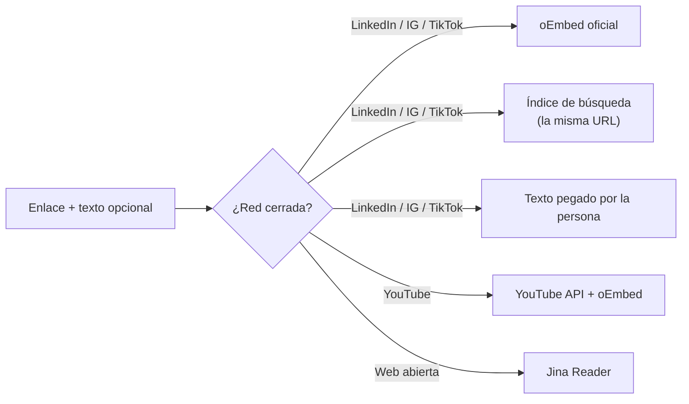

**Retención de datos de YouTube:** las políticas de la YouTube API exigen borrar o refrescar en 30 días los datos guardados. `purgeExpiredYouTube()` borra las señales de YouTube cuyo `last_seen_at` tiene más de 30 días; cada nueva búsqueda que las vuelve a encontrar las refresca. Se ejecuta al inicio de `POST /api/discover` y de `POST /api/analyze-url`.

**Métricas derivadas y atribución:** Outlier, velocidad, peso del autor, etapa y JEV son cálculos propios y la interfaz los presenta como tales. El pie de página atribuye los datos a YouTube y enlaza sus Términos de servicio y la Política de privacidad de Google.

## 7b-ter. Privacidad: nada de datos personales

Restricción 08 del reto: *solo contenido público y nada de datos personales*. El motor analiza **piezas**, no personas:

| Se guarda | No se guarda |
|---|---|
| URL pública de la pieza (necesaria para citarla) | Nombre, handle, URL de perfil o foto del autor |
| Texto público de la pieza (título, extracto) | Miniaturas (pueden mostrar rostros) |
| Cifras agregadas de la cuenta: seguidores, promedio de vistas | IDs de canal o de cuenta |
| Métricas de la pieza | Nombre de quien envía un enlace al Sensor |

- Las URLs de algunas redes contienen el handle (`tiktok.com/@cuenta/…`): es la dirección pública del contenido, no un perfil guardado. No se extrae ni se indexa por separado.
- "Autor vs. contenido" se resuelve con cifras (seguidores, promedio, Outlier), sin identidad. A Gemini no se le envía ningún nombre ni handle, y se le pide no nombrar personas en sus respuestas.
- `002_privacy.sql` elimina las columnas de identidad y limpia `raw`. El repositorio SQLite aplica la misma limpieza al abrir una base existente.

## 7b-quater. Radar semanal: los 10 temas que más crecen

Responde el entregable del reto: *"¿cuáles son los 10 temas de IA que más están creciendo esta semana, por qué y cómo lo adaptamos?"*.

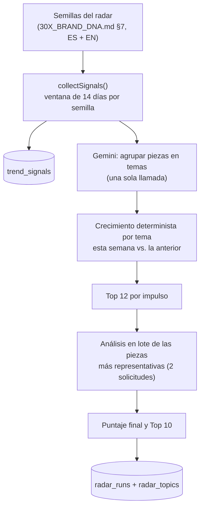

**Por qué una ventana de 14 días:** con una sola búsqueda por semilla se ven las dos semanas. La fecha de cada pieza es exacta (YouTube la da la API; en LinkedIn, TikTok e Instagram sale del ID público), así que se cuentan las piezas de cada semana sin pagar una segunda búsqueda.

**Métricas por tema (deterministas):**
```
esta_semana   = piezas publicadas en los últimos 7 días
semana_previa = piezas publicadas entre 8 y 14 días atrás
crecimiento   = clamp(50 + 30 · log2((esta_semana + 1) / (semana_previa + 1)), 0, 100)
volumen       = min(100, 10 · esta_semana)
etapa         = evaluateStage(piezas del tema)       (misma regla de §4.3)
JEV del tema  = JEV de su pieza más representativa
puntaje       = 0.5 · crecimiento + 0.2 · volumen + 0.3 · JEV
```
Un tema que pasa de 2 a 8 piezas obtiene un crecimiento de 50 + 30·log2(9/3) ≈ 98. Si no cambia, se queda en 50.

**Costo por corrida** (4 redes, 8 semillas): YouTube ≈ 816 unidades (8 % de la cuota diaria gratuita), Tavily ≈ 24 créditos en profundidad `basic`, Gemini **3 solicitudes** (1 agrupación + 2 de análisis en lote, §5.1). Las piezas ya analizadas no se vuelven a pagar.

**Semana anclada a la cobertura del índice:** los buscadores tardan días en indexar LinkedIn, Instagram y TikTok (verificado: el 18 de octubre el índice de LinkedIn llegaba al 13). Medir contra "hoy" hacía que casi todo pareciera decrecer. Por eso cada red se ancla a la fecha más reciente que ya tiene indexada y se compara la última semana cubierta con la anterior. YouTube (API en tiempo real) queda anclado a hoy. La interfaz muestra hasta qué fecha llega cada índice.

**Evidencia mínima:** un tema entra al ranking solo si tiene al menos 2 piezas dentro de las dos semanas medidas. Las piezas sin fecha no cuentan para el crecimiento.

**Guiones que fallan:** si la solicitud de guiones falla (red o cuota), la autopsia y el JEV se guardan igual con `scripts_error`. La interfaz ofrece "Generar guiones de nuevo" y el siguiente radar los regenera solo.

## 7b-quinquies. Perfiles de marca: hecho para 30X, útil para cualquiera

El planteamiento del reto dice que *"es el mismo problema que tiene cualquier marca, medio o creador"*. Por eso todo lo que era específico de 30X vive en un **perfil de marca**, guardado en la base de datos (funciona igual en local y en la nube, donde los archivos son de solo lectura):

| Campo | 30X (perfil por defecto) | Para qué se usa |
|---|---|---|
| `name` | 30X | Títulos y prompts |
| `audience` | Ejecutivos, líderes y equipos de LatAm aprendiendo IA | Matriz JEV: "¿le sirve a **esta** audiencia?" |
| `topic_scope` | IA aplicada a negocios y equipos | Agrupador de temas: qué piezas quedan fuera |
| `personal_label` | @andresbilbao | Guion de Reel en voz personal (fundador, creador) |
| `brand_label` | @30x | Carrusel en voz de marca |
| `dna` | Contenido de `docs/30X_BRAND_DNA.md` | Reglas de voz, JEV, prohibiciones |
| `seeds` | 8 semillas ES + EN | Búsquedas del Radar semanal |

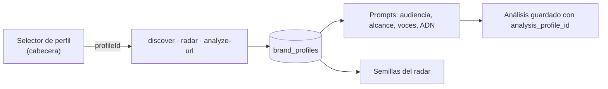

- **Perfil por defecto:** al arrancar, si no hay perfiles, se crea "30X" a partir de `docs/30X_BRAND_DNA.md`, y los análisis y radares anteriores se asignan a ese perfil.
- **Un análisis pertenece a un perfil.** El JEV de una pieza para 30X no vale para otra marca, así que cada análisis guarda `analysis_profile_id`. Si cambias de perfil, esa pieza aparece como "sin analizar" para el nuevo perfil hasta que la analices. Los filtros que dependen de la IA (JEV, formato detallado, estado, orden por JEV) consideran solo los análisis del perfil activo.
- **Guiones genéricos:** `personal_reel` (voz personal) y `brand_carousel` (voz de marca). Los análisis antiguos (`andres_bilbao_reel`, `x30_carousel`) se leen con compatibilidad. Cada análisis guarda una copia de las etiquetas del perfil para mostrarlas y exportarlas.
- **El JEV se generaliza sin perder el nombre:** los 3 criterios (impacto, aplicabilidad, claridad) se evalúan para la audiencia del perfil.
- **Selección por navegador:** el perfil activo se guarda en el navegador y viaja en cada petición (`profileId`), así dos personas pueden usar perfiles distintos a la vez.

## 7b-sexies. Vistas guardadas

Combinaciones de filtros con nombre ("Emergentes de LinkedIn con JEV ≥ 70"), guardadas en la tabla `saved_views` por perfil. Son compartidas por el equipo y se aplican con un clic.

## 7b-septies. Demo y acceso

**Código de acceso (`DEMO_ACCESS_CODE`):** si la app se publica en una URL, cualquiera podría gastar la cuota diaria de Gemini, YouTube y Tavily. Con `DEMO_ACCESS_CODE` definido, `src/proxy.ts` (Proxy de Next 16, runtime Node) exige una cookie de acceso:

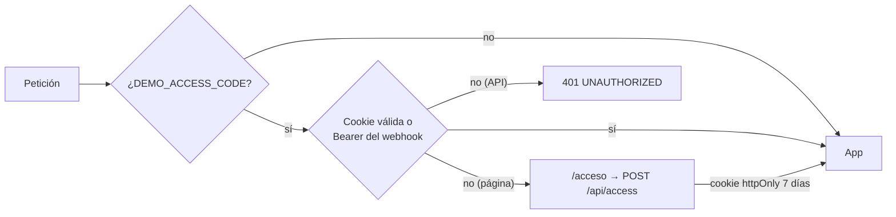

- La cookie guarda un hash SHA-256 del código, no el código. La comparación es de tiempo constante y un código incorrecto espera 600 ms (frena la fuerza bruta).
- Los webhooks externos al Sensor siguen entrando con `Authorization: Bearer $INGEST_WEBHOOK_SECRET`.

**Radar precargado (`npm run demo:prepare`):** corre el radar del perfil principal en LinkedIn (la pregunta del entregable) y opcionalmente en las 4 redes, directamente con la biblioteca, sin servidor. Usa 3 solicitudes de Gemini por radar. Así la demo abre con resultados al instante, sin depender de la cuota ni de la latencia en vivo.

## 7c. Diagnóstico de conexiones (`npm run doctor`)

`scripts/doctor.ts` lee `.env.local` y prueba cada servicio con la llamada **más barata posible** contra la API real, sin escribir datos:

| Servicio | Prueba | Costo |
|---|---|---|
| Gemini | `models.get` del modelo configurado | 0 tokens |
| YouTube Data API | `videos.list` de un video público | 1 unidad de cuota |
| Tavily | búsqueda `basic` de 1 resultado | 1 crédito |
| Google CSE | consulta de 1 resultado | 1 consulta |
| Jina Reader | lectura de `https://example.com` | mínima |
| Supabase | `count` sobre `trend_signals` (confirma que la migración está aplicada) | 0 |
| Notion | lectura del esquema de la base | 0 |
| Slack / Make | solo formato de la URL (probarlos enviaría un mensaje real) | 0 |

Nunca imprime valores de claves: solo `OK`, `FALTA` o el error del proveedor. Sale con código 1 si falla algo **mínimo** para operar (Gemini + al menos una fuente de descubrimiento).

## 8. Limitaciones conocidas

- **Jina Reader anónimo** puede bloquear dominios muy consultados (verificado: `youtube.com` devolvió 403 sin clave). Para YouTube no importa porque el sensor usa la YouTube API + oEmbed; para LinkedIn conviene configurar `JINA_API_KEY`.
- **Google Programmable Search JSON API**: Google la cerró a clientes nuevos y anunció su retiro; por eso Tavily es el proveedor principal y CSE solo un respaldo para quien ya tenga clave.
- **Etapa `emerging`** depende de que la cohorte mezcle idiomas. Mitigado en Fase 3: `/api/discover` traduce la consulta y busca también en inglés (`bilingual: true`, requiere Gemini). Sin Gemini, la cohorte queda en el idioma de la consulta y la etapa puede sesgarse.
- **Etapa de una URL aislada** (Sensor de Comunidad) es provisional: cohorte de 1.
- **Secreto de webhooks**: la excepción de mismo origen se basa en la cabecera `Origin`, que un cliente no-navegador puede falsificar. Es una barrera contra llamadas casuales, no autenticación de usuarios; para exponerlo en internet hace falta login (fuera del alcance del hackathon).
- **Costo de YouTube con `bilingual`**: duplica la cuota (≈ 204 unidades por búsqueda). Se limita a una sola variante extra para no triplicarla.
- **Sin autenticación de usuarios**: `/api/discover` y `/api/export-30x` quedan abiertos a quien llegue a la URL y pueden consumir cuota. Para el hackathon se despliega en red privada o detrás de la protección del hosting (p. ej. Vercel Deployment Protection).
- **Enlaces externos**: solo se guardan y renderizan URLs http(s) (las de índices SERP, solo `https://`); React escapa todo el texto de terceros.
- **Outlier en SERP**: sin promedio del autor no se calcula (queda `null`), por diseño, para no inventar métricas.

## 9. Decisiones registradas (ADR corto)

| # | Decisión | Motivo |
|---|---|---|
| 1 | `node:sqlite` en lugar de Prisma/Drizzle para el fallback | Sin dependencias nativas ni `prisma generate`; arranca en 2 min en cualquier máquina con Node 22+. |
| 2 | Tavily como SERP principal, Google CSE como respaldo | Tavily filtra por dominio y ventana temporal en una llamada; CSE cubre si no hay clave de Tavily. |
| 3 | Fecha de publicación desde el ID de la URL | Dato exacto, público y legal; los índices a menudo no traen la fecha. |
| 4 | Score JEV ponderado en código, no por el LLM | Reproducible y auditable para el jurado; el LLM solo argumenta cada criterio. |
| 5 | Adaptación solo si JEV ≥ umbral | Ahorra ~1/3 del costo de IA en piezas que no sirven a la audiencia LatAm. |
| 6 | Jina Reader **solo para la web abierta** (blogs, medios, docs) | Pedirle a un tercero que descargue LinkedIn, Instagram o TikTok sigue siendo scraping de redes cuyos términos lo prohíben. En redes cerradas el Sensor usa solo oEmbed oficial, el índice de búsqueda y el texto que aporta la persona. |
| 7 | Búsqueda bilingüe por defecto | La etapa `emerging` necesita comparar inglés vs. español; una sola consulta en español no puede detectarla. |
| 9 | `gemini-3.8-flash` en lugar de `gemini-2.5-flash` | La especificación pedía 2.5-flash, pero Google ya no lo habilita para cuentas nuevas (404 al generar). 3.8-flash es el Flash estable vigente y se verificó con Structured Outputs. Se fija la versión en lugar de `gemini-flash-latest` para que los resultados sean reproducibles. |
| 8 | Notion por descubrimiento de esquema | Cada equipo tiene su propia base de contenidos; exigir columnas fijas rompe el plug & play. |
| 10 | Vercel + Supabase para publicar | Gratis para el hackathon, despliegue automático en cada `git push` y funciones de hasta 300 s (lo que tarda un radar). Supabase porque el disco de Vercel es efímero. La copia `db:push` evita gastar cuota de Gemini para poblar la nube. |
