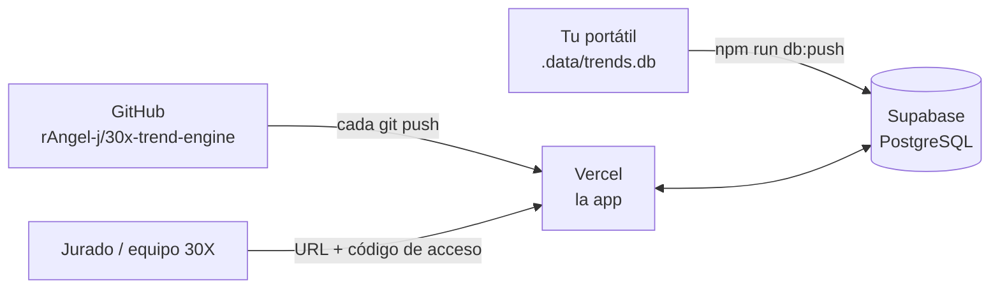

# Publicar la app en una URL

Guía para dejar **30X Radar de tendencias** funcionando en una dirección pública (por ejemplo `https://30x-radar.vercel.app`), protegida con un código de acceso y con el radar ya preparado. Tarda unos **15 minutos** y es **gratis**.

| Pieza | Servicio | Por qué |
|---|---|---|
| La app | [Vercel](https://vercel.com), plan Hobby (gratis) | Es el hosting oficial de Next.js, se conecta a GitHub y publica cada `git push` solo. Permite funciones de hasta 300 s, que es lo que tarda un radar. |
| La base de datos | [Supabase](https://supabase.com), plan Free | En Vercel el disco se borra en cada despliegue: SQLite no sirve para guardar. Supabase es PostgreSQL y la app lo usa sola con dos variables. |

> **Tus claves solo se escriben en los paneles de Vercel y Supabase y en tu `.env.local`.** Nunca en el código, en GitHub ni en el chat.



---

## Paso 1 · Crear la base en Supabase (5 min)

1. Entra a <https://supabase.com> → **Start your project** → inicia sesión con GitHub.
2. **New project**: nombre `30x-radar`, una contraseña de base de datos (guárdala, aunque la app no la usa) y la región más cercana (por ejemplo *South America (São Paulo)* o *East US*). Espera 1-2 minutos a que se cree.
3. Menú izquierdo → **SQL Editor** → **New query**. Abre [`supabase/setup.sql`](../supabase/setup.sql), copia **todo** el contenido, pégalo y pulsa **Run**. Debe decir *Success. No rows returned*.
4. Copia dos valores, que necesitarás en los pasos 2 y 3:
   - **URL del proyecto**: botón **Connect** (arriba) o *Project Settings → Data API*. Tiene la forma `https://xxxx.supabase.co`.
   - **Clave secreta**: *Project Settings → API Keys* → la **secret key** (`sb_secret_…`) o, en proyectos antiguos, la **service_role**. **No** la *publishable/anon*.

## Paso 2 · Subir el radar que ya tienes (1 min)

Así la app publicada abre con los temas, autopsias y guiones ya preparados, **sin gastar cuota de Gemini otra vez**.

1. En tu `.env.local` añade (o completa) estas dos líneas con los valores del paso 1:

   ```
   SUPABASE_URL=https://xxxx.supabase.co
   SUPABASE_SERVICE_ROLE_KEY=sb_secret_xxxx
   ```

2. Ejecuta:

   ```bash
   npm run db:push
   ```

   Copia perfiles, piezas, análisis, radares y vistas desde `.data/trends.db`. No llama a ninguna IA. Debe terminar con *Listo*.

> Desde este momento la app **local** también guarda en Supabase (mismo `.env.local`). Si quieres volver a SQLite local, borra esas dos líneas.

## Paso 3 · Publicar en Vercel (5 min)

1. Entra a <https://vercel.com/signup> → **Continue with GitHub** (plan *Hobby*).
2. **Add New… → Project** → en *Import Git Repository* elige **30x-trend-engine** (si no aparece: *Adjust GitHub App Permissions* y dale acceso a ese repositorio).
3. Vercel detecta Next.js solo: no cambies *Build Command* ni *Output Directory*.
4. Abre **Environment Variables** y añade una por una (nombre → valor). Copia los valores de tu `.env.local`:

   | Variable | Obligatoria | Valor |
   |---|---|---|
   | `SUPABASE_URL` | Sí | La del paso 1 |
   | `SUPABASE_SERVICE_ROLE_KEY` | Sí | La clave secreta del paso 1 |
   | `DEMO_ACCESS_CODE` | **Sí** | Un código que inventes (ej. `radar-30x-2026`). Sin él, cualquiera con la URL gastaría tu cuota diaria. |
   | `GEMINI_API_KEY` | Sí | La de tu `.env.local` |
   | `GEMINI_MODEL` | Sí | `gemini-3.8-flash` |
   | `YOUTUBE_API_KEY` | Sí | La de tu `.env.local` |
   | `TAVILY_API_KEY` | Sí | La de tu `.env.local` |
   | `INGEST_WEBHOOK_SECRET` | Si usas webhooks | La de tu `.env.local` |
   | `SLACK_WEBHOOK_URL`, `NOTION_API_KEY`, `NOTION_DATABASE_ID`, `MAKE_WEBHOOK_URL` | Opcional | Para el envío en un clic |

   **No** añadas `SQLITE_PATH`.

5. Pulsa **Deploy**. En 1-2 minutos te da la URL (`https://30x-trend-engine-xxxx.vercel.app`).
6. Opcional: *Settings → Domains* para un nombre más corto, por ejemplo `30x-radar.vercel.app`.

## Paso 4 · Comprobar (2 min)

1. Abre la URL → te pide el código de acceso → escríbelo.
2. Debe abrir con **"Los 7 temas que más crecen esta semana"** (lo que subiste en el paso 2).
3. Abre **Conexiones** (arriba a la derecha): *Base de datos en la nube* debe salir conectada.
4. No pulses **Actualizar radar** en la prueba: cada radar usa 3 de las 20 solicitudes diarias del plan gratuito de Gemini.

## Compartir

Envía **la URL y el código de acceso** por separado, por ejemplo:

> Radar de tendencias de 30X: https://30x-radar.vercel.app · código: `radar-30x-2026`

Cada vez que hagas `git push` a `main`, Vercel publica la versión nueva solo, en la misma URL.

---

## Bueno saber

- **Cuota de IA compartida:** todos los que entran usan tu cuota gratuita de Gemini (20 solicitudes al día). Ver el radar guardado no gasta nada; *Actualizar radar* gasta 3 y el Sensor de Comunidad 2.
- **Supabase pausa los proyectos gratuitos** tras una semana sin uso. Si pasa, entra al panel y pulsa *Restore* (los datos se conservan). Ábrela la víspera de la demo.
- **El plan Hobby de Vercel es para uso no comercial**, ideal para el hackathon y para que 30X lo pruebe. Si 30X lo adopta, lo despliega en su propia cuenta (Vercel Pro o cualquier hosting Node con funciones de 300 s) con las mismas variables.
- **Cambiar el código de acceso:** *Vercel → Settings → Environment Variables* → editar `DEMO_ACCESS_CODE` → *Deployments → Redeploy*.
- **Sin Supabase** la app arranca igual en Vercel, pero guarda en un disco temporal que se borra: no sirve para publicar.

## Plan B: compartir desde tu portátil sin publicar

Si solo necesitas una URL por unas horas, con tu portátil encendido: `npm run build && npm start` y luego un túnel gratuito sin cuenta, como Cloudflare Quick Tunnel (`cloudflared tunnel --url http://localhost:3000`), que imprime una URL `https://….trycloudflare.com`. Define igual `DEMO_ACCESS_CODE` en `.env.local`. La URL cambia cada vez y deja de funcionar cuando apagas el portátil.

## Problemas frecuentes

| Síntoma | Causa | Solución |
|---|---|---|
| `npm run db:push` → "¿ejecutaste supabase/setup.sql?" | Las tablas no existen | Paso 1.3 |
| `npm run db:push` → "ya tiene perfiles" | La app publicada se abrió antes de subir los datos y creó un perfil vacío | `npm run db:push -- --force` |
| La URL abre vacía, sin temas | Faltó el paso 2, o Vercel no tiene `SUPABASE_URL` | Paso 2 y revisar variables → *Redeploy* |
| "Cuota diaria de Gemini agotada" | Se gastaron las 20 solicitudes del día | Esperar a la renovación (la app indica la hora) |
| Error 504 al actualizar el radar | El proyecto de Vercel tiene un límite de duración menor | *Settings → Functions → Max Duration* a 300 s |
